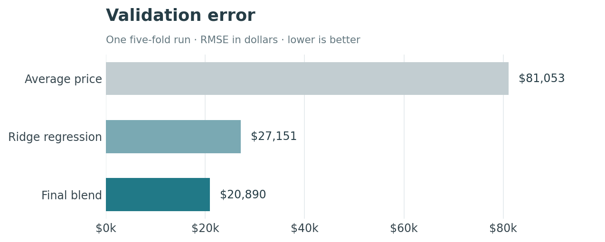

# House Price Prediction

**Data Bootcamp · Project 2**

Daniyal · Zori · Danial

[Open the notebook](house_price_model.ipynb) · [Results](#results) · [Run the project](#run-the-project)

We used house size, location, age and other features to predict sale prices in Ames, Iowa. The data has **1,200 training houses** and **260 test houses**.

## Results

| Run | RMSE | Where it was measured |
| :--- | ---: | :--- |
| First model submission, v1 | 20,204.15 | Kaggle public leaderboard |
| Model submission, v3 | **14,352.98** | Kaggle public leaderboard |
| Final blend, local validation | 20,678.78 | Three five-fold runs, pooled |
| Provided-answer submission, v4 | 0.00 | Kaggle public leaderboard |

Lower RMSE is better. Kaggle scores only part of the test data, so its public score can differ from local validation.

**About v4:** the download included `solns.csv`, which contains test sale prices. Those values were submitted directly for v4. The zero score came from that file. The model code uses `train.csv` for training, and the notebook explains the answer-file entry separately.

## How the model works

1. Fill missing values and turn categories into usable inputs.
2. Add features such as total floor area, bathrooms and house age.
3. Compare models using the same validation splits.
4. Average predictions from **SVR (57.17%)**, **Elastic Net (32.74%)** and **LightGBM (10.09%)**.

The models learn log prices; predictions are converted back to dollars before scoring. For houses larger than every training example, the main version uses three similar sales in the same neighborhood. The notebook also checks a version using one similar sale.



*The chart shows one five-fold run. The results table pools all three runs.*

## Run the project

Use Python 3.12. Put `train.csv`, `test.csv` and `sample_soln.csv` from the [competition](https://www.kaggle.com/competitions/regression-for-house-prices/data) in `data/`.

```bash
python -m pip install -r requirements.txt
python train.py
python -m jupyterlab house_price_model.ipynb
```

Predictions are saved in `outputs/`. Their IDs follow the sample file: **0–259**. The input test IDs are **1201–1460**.

## What's included

| File | What it does |
| :--- | :--- |
| [house_price_model.ipynb](house_price_model.ipynb) | Explains the work, with saved tables and plots |
| [train.py](train.py) | Fits the models and writes the submission files |
| [house_models.py](house_models.py) | Handles features, model setup and similar-house predictions |
| [results/](results/) | Records the 90 model setups and 520 validation fits |
| [config/final_model.json](config/final_model.json) | Stores the final settings and weights |

The validation scores helped choose the weights, so they may be optimistic. The large-house rule also rests on very few examples. The notebook covers both points and the separate comparison with the provided answers.

ChatGPT helped with the code, experiments and editing.
